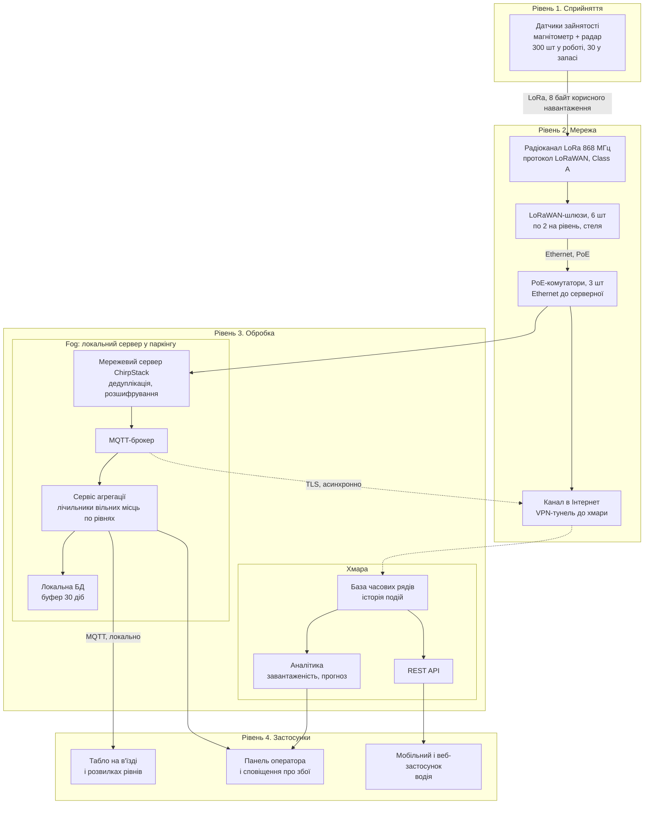
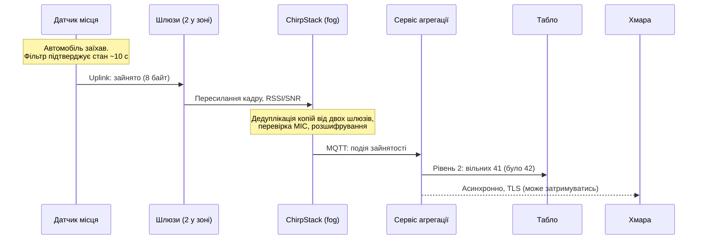
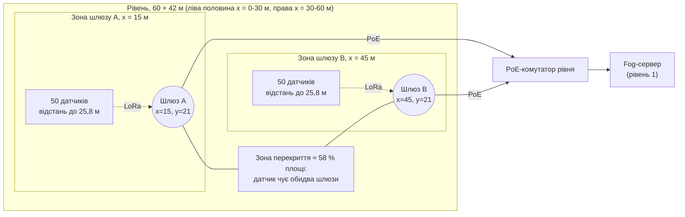
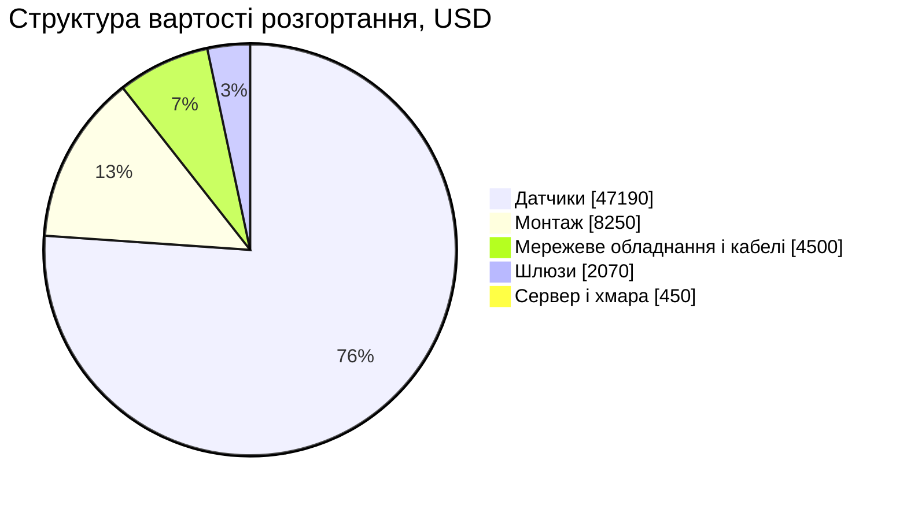

# Практична робота 1. Розумне паркування на 300 місць (варіант 3)

**Дисципліна:** Технології IoT та SMART-технології
**Тема:** Вступ до IoT та SMART-технологій
**Тип роботи:** аналітично-проєктна (без програмування)

## 1. Мета та вихідні припущення

Спроєктувати на рівні архітектури систему визначення зайнятості місць для міського паркінгу на 300 місць: обрати датчики, мережеву топологію й протокол, розрахувати кількість шлюзів та оцінити вартість розгортання.

Завдання не задає геометрію паркінгу, тому я фіксую модель, на якій побудовано всі розрахунки нижче:

| Параметр | Значення | Статус |
|---|---|---|
| Кількість місць | 300 | задано |
| Конструкція | закритий паркінг, 3 рівні по 100 місць | припущення |
| Розмір рівня | 60 × 42 м = 2520 м² (≈ 25 м² на місце разом із проїздами) | припущення |
| Перекриття між рівнями | залізобетон | припущення |
| Середня кількість паркувань на місце за добу | 6 (тобто 12 змін стану «зайнято/вільно») | припущення |
| Частка добових подій у годину пік | 20 % | припущення |
| Heartbeat (контрольне повідомлення) | 1 раз на годину | проєктне рішення |
| Частотний план | EU868 (Україна — UA868, див. розділ 5.5) | проєктне рішення |

Усі числа, позначені «припущення», можна змінити; формули наведені, тож розрахунок легко перерахувати.

## 2. Архітектура системи

### 2.1. Чотирирівнева діаграма

Шари (сприйняття, мережа, обробка, застосунки) відповідають еталонній моделі IoT за ITU-T Y.2060 [27]. Діаграми написано в синтаксисі Mermaid [28].

Ключова особливість: **критичний шлях «автомобіль зупинився → табло оновилося» не залишає будівлі**. Хмара потрібна для історії, аналітики та мобільного застосунку, але відмова Інтернету не зупиняє табло.

### 2.2. Послідовність обміну для однієї події

## 3. Склад системи

| № | Пристрій / компонент | Що вимірює або робить | Де розміщено |
|---|---|---|---|
| 1 | Датчик зайнятості місця (330 шт: 300 + 10 % запасу) | Магнітометр фіксує зміну магнітного поля від металевого корпусу авто, радар підтверджує присутність; передає стан, напругу батареї, температуру | На покритті кожного місця, поверхневий монтаж по центру місця |
| 2 | LoRaWAN-шлюз (6 шт) | Приймає радіокадри датчиків і пересилає їх мережевому серверу по Ethernet | Під стелею, по 2 на рівень (координати в розділі 6) |
| 3 | PoE-комутатор (3 шт, по одному на рівень) | Живить шлюзи по кабелю та об'єднує їх у локальну мережу | Технічна ніша кожного рівня |
| 4 | Локальний сервер (fog) | Мережевий сервер LoRaWAN, MQTT-брокер, сервіс агрегації, локальна БД | Серверна / технічна кімната на першому рівні |
| 5 | ДБЖ | Тримає сервер, комутатори та шлюзи під час короткого зникнення мережі | Поруч із сервером |
| 6 | Інформаційні табло | Показують кількість вільних місць по рівнях | В'їзд, розвилки до рівнів |
| 7 | Хмарний сервіс | Зберігає історію, рахує аналітику, віддає API | Дата-центр хмарного провайдера |
| 8 | Застосунок водія та панель оператора | Показують наявність місць; повідомляють оператору про несправні датчики | Смартфони, робоче місце оператора |

## 4. Де виконується обробка: edge, fog чи хмара

Вимога до затримки, що визначила вибір: **оновлення табло повинне відбуватися не довше ніж через 10 с після того, як авто зупинилось**. Це проєктна вимога (водій на в'їзді приймає рішення за секунди). Вона розкладається так: ~10 с — підтвердження стану на самому датчику, до 1–2 с — радіоканал і локальна обробка. Хмарний маршрут додає невизначену затримку каналу в Інтернет (від сотень мілісекунд до втрати зв'язку), тому на критичному шляху його немає.

| Задача | Рівень | Чому саме тут |
|---|---|---|
| Злиття сигналів магнітометра й радара, фільтр від брязкоту стану (debounce ~10 с), відправка лише при зміні стану плюс heartbeat | **Edge** (у датчику) | Радіопередача — головна стаття витрат енергії та ефіру; відправляти кожен відлік магнітометра неможливо ні за батареєю, ні за лімітом 1 % ефірного часу |
| Дедуплікація копій кадру від двох шлюзів, перевірка MIC, розшифрування, декодування 8 байт | **Fog** | Потрібно для кожної події одразу; не залежить від Інтернету |
| Підрахунок вільних місць по рівнях, керування табло | **Fog** | Вимога ≤ 10 с, працює при обриві зв'язку з хмарою |
| Виявлення «мовчазних» датчиків (немає heartbeat > 3 год) і сповіщення оператора | **Fog** | Оператор паркінгу має знати про збій навіть без Інтернету |
| Буфер подій (30 діб) | **Fog** | Після відновлення зв'язку події синхронізуються в хмару без втрат |
| Довгострокова історія, аналітика завантаженості, прогноз, публічний API, мобільний застосунок | **Хмара** | Потрібні масштаб, зберігання роками й доступ ззовні; затримка в десятки секунд припустима |

Резюме по затримках:

| Споживач даних | Допустима затримка | Місце обробки |
|---|---|---|
| Табло на в'їзді | ≤ 10 с | Fog |
| Сповіщення оператора про збій датчика | хвилини | Fog |
| Мобільний застосунок водія | ≤ 30–60 с | Хмара |
| Аналітика і звіти | години | Хмара |

## 5. Датчики, топологія й розрахунок мережі

### 5.1. Порівняння двох варіантів датчиків

| Критерій | Варіант A. Магнітометр + радар, поверхневий монтаж на місці | Варіант B. Ультразвуковий датчик над місцем (стеля) |
|---|---|---|
| Принцип | Зміна магнітного поля від металу авто + мікрохвильовий радар, що відсікає завади від сусідніх авто [1][2] | Вимірювання відстані до об'єкта за часом відлуння; авто на місці скорочує відстань до стелі [5][6] |
| Приклади та ціна | MOKOSMART LW009-SM, $119 [1]; Dingtek DO100 (лише магнітний), $167 [3]; радар+магніт Dingtek DO202, $176 [4] | Linovision IOT-S500MUD, €199 (без мита й ПДВ), діапазон 3–450 см [5]; Dingtek DO201 (ультразвук + магніт), $130 [7] |
| Батарея | Літієва 3,6 В, 20 А·год, 5 років за типових умов [1] | До 10 років за даними виробника [5] |
| Заявлена точність | > 99 % [1] | Не наведена у джерелі [5] |
| Монтаж | Приклеюється/кріпиться до покриття, жодних робіт на стелі; витримує проїзд (10 т) [1] | Потрібна точка кріплення над кожним місцем; залежить від висоти та конструкцій стелі (труби, вентиляція) |
| Ризики | Металеві конструкції та сусідні авто створюють завади (компенсує радар); датчик на підлозі піддається механічним впливам і снігу/воді (IP68 [1]) | Високий кузов, багажник на даху, підвішені предмети спотворюють вимірювання; зміна геометрії стелі при ремонті; кут променя вузький (8°) і потребує точного наведення [6] |
| Підходить для | Відкриті й закриті майданчики | Лише закриті паркінги з рівною стелею |

> Усі характеристики в таблиці — заяви виробників з їхніх сторінок, незалежно не перевірені.

**Вибір: варіант A.** Причини: (1) у закритому паркінгу з щільним розташуванням авто магнітний датчик без радара ненадійний, а об'єднаний датчик знімає цю проблему; (2) монтаж не залежить від стелі; (3) ціна одиниці нижча ($119 проти €199 без мита); (4) для варіанта B виробник у використаному джерелі не наводить точність детекції. Недолік варіанта A — менша заявлена тривалість роботи батареї (5 років проти 10) — прийнятий свідомо: заміну датчиків раз на 5 років можна поєднати з ремонтом покриття. Ультразвуковий варіант B залишаю як резервний для зон, де датчики на підлозі неможливі (рампи з ухилом, місця з ремонтом покриття).

### 5.2. Мережева топологія та вибір протоколу

**Топологія — «зірка зірок» LoRaWAN:** датчики підключені до шлюзів по радіо, шлюзи — до мережевого сервера по Ethernet [8]. Датчики не ретранслюють чужі кадри, тому не споживають енергію на маршрутизацію.

**Чому LoRaWAN для 300 вузлів**

| Альтернатива | Чому поступається в цій задачі |
|---|---|
| Wi-Fi | Висока потужність передачі, батарея вичерпається за місяці; 300 клієнтів вимагатимуть щільної мережі точок доступу |
| BLE / Zigbee mesh | Мала дальність (десятки метрів), для 300 вузлів потрібні ретранслятори на кожному кроці; ретрансляція витрачає енергію; складніше керувати |
| NB-IoT / LTE-M | Потребує SIM-карту й абонплату на кожен з 300 датчиків; покриття в підземних рівнях не гарантоване; мережею керує оператор |
| Sigfox | Низький ліміт повідомлень на добу для частих змін стану (обговорюється в спільноті TTN [9]) |
| **LoRaWAN** | Дальність до 500–1000 м за даними виробника датчика [1] (у приміщенні значно менше); без абонплати за кожен датчик (приватна мережа); 5 років автономності [1]; відкритий стандарт, сумісність виробників [10]; шифрування AES-128 [11] |

Додаткові аргументи:

- **Проникнення у підземні рівні.** У тесті SmartMakers зі шлюзом на даху будівлі стабільний прийом вимірювався аж до підземного паркінгу [12]. Це якісна ознака, а не гарантія для нашого об'єкта: перед закупівлею потрібне натурне вимірювання рівня сигналу.
- **Масштаб.** Один шлюз Milesight UG65 обслуговує понад 2000 вузлів [13], а нам на кожен шлюз припадає у середньому 50 датчиків.
- **Власна мережа.** Ми розгортаємо власний мережевий сервер (ChirpStack у fog), тому не залежимо від політики публічних мереж; обмеження на обсяг даних визначаються лише законодавчим лімітом ефірного часу (розділ 5.4).

**Клас пристрою — Class A:** датчик передає, коли змінився стан, і відкриває два короткі вікна прийому після передачі. Такий режим найекономніший; нам не потрібні команди «зверху» (крім рідкісного налаштування). Для періодичного heartbeat використовуємо **непідтверджені** кадри, щоб не навантажувати шлюзи downlink-трафіком.

**Протоколи вище мережі:** LoRaWAN → ChirpStack → **MQTT** (легковаговий протокол «публікація/підписка», зручний для кількох споживачів: сервіс агрегації, панель, вивантаження в хмару) [14].

### 5.3. Обсяг телеметрії та ефірний час

**Формат повідомлення (8 байт корисного навантаження):**

| Байти | Поле |
|---|---|
| 1 | Прапорці: зайнято, збій датчика, вскрито, низький заряд |
| 1 | Напруга батареї |
| 1 | Температура |
| 2 | Лічильник повідомлень |
| 2 | Тривалість поточного стану, хв |
| 1 | Резерв |

З урахуванням ≥ 13 байт службової частини LoRaWAN [15] фізичний кадр має ≈ 21 байт.

**Кількість повідомлень**

- Події: 12 змін стану на місце на добу (припущення).
- Heartbeat: 24 на добу.
- На один датчик: 12 + 24 = **36 повідомлень/добу**.
- На всю систему: 300 × 36 = **10 800 повідомлень/добу** (≈ 0,125 повідомлення на секунду в середньому).

**Об'єм даних**

- Корисне навантаження: 10 800 × 8 байт ≈ **84 КБ/добу**.
- У MQTT після декодування в JSON (≈ 300 байт на повідомлення, оцінка): ≈ **3,2 МБ/добу**.
- Записів у базі часових рядів: 10 800 × 365 ≈ **3,9 млн/рік**.

Це дуже мало: система не навантажує ні канал в Інтернет, ні базу даних, і сама по собі не виправдовує хмарну обробку «в реальному часі».

**Ефірний час (airtime) одного кадру 21 байт**, смуга 125 кГц, кодування 4/5, преамбула 8 символів, CRC увімкнено (формула Semtech для LoRa):

| Spreading factor | Airtime кадру | Airtime датчика за добу (36 кадрів) | Частка ліміту 1 % (864 с/добу) [16] |
|---|---|---|---|
| SF7 | 56,6 мс | 2,0 с | 0,24 % |
| SF9 | 185,3 мс | 6,7 с | 0,77 % |
| SF12 | 1482,8 мс | 53,4 с | 6,2 % |

Тобто навіть у найгіршому режимі SF12 датчик використовує лише 6,2 % дозволеного ефірного часу (його фактичний duty cycle — близько 0,06 %).

**Навантаження на канал у годину пік.** Подій за годину: 20 % від 3600 доби = 720, плюс 300 heartbeat → **1020 кадрів/год ≈ 0,28 кадр/с**. Модель чистої ALOHA (консервативна, не враховує ефект захоплення й ортогональність SF):

| Режим | Навантаження на канал | Ймовірність успішного прийому |
|---|---|---|
| SF9, 3 канали (мінімальний набір EU868) | 1,75 % | 96,6 % |
| SF9, 8 каналів | 0,66 % | 98,7 % |
| SF12, 3 канали | 14,0 % | 75,6 % |

Висновок: датчики повинні працювати на SF7–SF9 під управлінням ADR (чого досягаємо густою розстановкою шлюзів), а SF12 — лише як виняток для найвіддаленіших. Крім того, кожна подія приймається двома шлюзами, що підвищує ймовірність доставки. Для аварійного сценарію «усі 300 авто одночасно роз'їжджаються за 5 хвилин» (SF9, 8 каналів) ймовірність успіху ≈ 95,5 %; втрачені кадри компенсує щогодинний heartbeat, що містить поточний стан.

**Енергобаланс.** Батарея 20 А·год на 5 років дає бюджет ≈ 0,46 мА середнього струму (20 000 мА·год / 43 800 год). Радіообмін за наших припущень (передача ≈ 40 мА, прийом ≈ 12 мА, ~1 с вікон прийому на кадр — типові значення для LoRa-трансиверів, не взяті з документації конкретного датчика) складає близько 0,2 мА·год на добу, тобто ≈ 2 % добового бюджету 10,96 мА·год. Решту займає опитування магнітометра та радара, саморозряд і BLE. Висновок: енергія радіо не є вузьким місцем, а 5 років робочого ресурсу залежить від алгоритму датчика — це слід перевірити на пілотній партії.

### 5.4. Вимоги до ефірного часу в Україні (регуляторне застереження)

Для 868 МГц законодавчий ліміт — duty cycle 1 % у більшості піддіапазонів [16]. У 2026 році Національна комісія регулювання зв'язку (НКЕК) опублікувала проєкт умов використання смуги 865–868 МГц: EIRP до 25 мВт, коефіцієнт підсилення антени до 9 дБі, duty cycle менше 1 %; обладнання не має захисту від завад [17]. Це **проєкт** (збір зауважень до 30.09.2026), тому остаточні вимоги перед закупівлею потрібно звірити. Проєкт відповідає параметрам, закладеним у розрахунки.

### 5.5. Частотний план

Для України в таблицях спільноти вказаний регіон UA868 [18]; TTN у своїй таблиці позначає статус як «невідомий, обмежений CEPT» [19]. Тому беремо обладнання EU868 і підтверджуємо відповідність регуляторним вимогам до закупівлі.

## 6. Розрахунок кількості шлюзів і вибір їх розміщення

### 6.1. Вихідні дані

- 3 рівні, 100 датчиків на рівень, площа рівня 60 × 42 м.
- Перекриття залізобетонні, тому **шлюз потрібен на кожному рівні**: товсті бетонні плити помітно послаблюють сигнал [20], а прийом у підземному паркінгу в тесті [12] вимірювався при шлюзі просто над ним, без оптимізації антен.
- Ефективний радіус приймання в межах рівня беру **35 м**. Це консервативна інженерна оцінка з урахуванням колон і стін: виробник шлюзу заявляє ≈ 2 км у міській забудові на відкритому просторі [13], виробник датчика — 500–1000 м [1], але такі цифри для багаторівневого паркінгу недосяжні.

### 6.2. Розрахунок

**За ємністю:** UG65 підтримує понад 2000 вузлів [13]; потрібно 100 на рівень. Ємність не обмежує: 100 / 2000 = 5 %.

**За покриттям (один шлюз на рівень).** Шлюз по центру рівня (30; 21) м. Найвіддаленіша точка — кут, до якого 36,6 м. Це більше за 35 м, отже ≈ 0,8 % площі (кути) лишаються без надійного покриття. Резервування відсутнє: вихід шлюзу з ладу залишає рівень без зв'язку.

**За покриттям і резервуванням (два шлюзи на рівень).** Розміщуємо шлюзи в точках (15; 21) і (45; 21) м:

- максимальна відстань до найближчого шлюзу — **25,8 м** (< 35 м): покриття 100 % площі;
- приблизно в 58 % площі датчик у зоні обох шлюзів (відстань ≤ 35 м до кожного): вихід одного шлюзу з ладу там не спричиняє втрати зв'язку;
- решта площі (≈ 42 %) покрита одним шлюзом, тому при відмові шлюзу частина датчиків тимчасово втратить зв'язок; fog-сервіс виявляє це за відсутністю heartbeat і сповіщає оператора. Повне резервування вимагало б 3 шлюзів на рівень, що непропорційно для даного масштабу.

**Підсумок: 2 шлюзи × 3 рівні = 6 шлюзів.**

Схема розміщення (рівень 1 з 3, вигляд зверху; на інших рівнях так само):

**Критерії розміщення**

1. Під стелею (≈ 3–3,5 м над покриттям): антена «бачить» приміщення поверх авто. Рекомендація виробників — нахил антени на 5–10° униз до пристроїв на рівні підлоги, таких як датчики паркування [20].
2. Шлюзи по осі рівня (y = 21 м) і на чвертях довжини, щоб максимальна відстань до найближчого шлюзу була найменшою.
3. Поруч із лінією живлення PoE та кабельною трасою до технічної ніші рівня.
4. Не поруч із вентиляційними коробами, металевими фермами й освітленням з імпульсними драйверами.
5. Перед остаточним монтажем — **вимірювання рівня сигналу** тестовим пристроєм (RSSI/SNR) у найвіддаленіших кутах; за потреби переставити шлюзи.

### 6.3. Вибір моделі шлюзу

Milesight UG65: 8 каналів на чипі SX1302, PoE, Ethernet, захищений корпус IP65, вбудований мережевий сервер і підтримка ChirpStack/TTI [13]. Ціна: ≈ $370 [21], ≈ €321 [22]. Використовуємо його лише як шлюз (передача кадрів на центральний ChirpStack), а вбудований мережевий сервер вимикаємо, щоб не мати 6 роз'єднаних серверів.

## 7. Оцінка вартості розгортання (порядок величини)

Ціни — це роздрібні котирування з відкритих магазинів станом на 24.10.2026, у різних валютах. Для оцінки порядку величини вважаю $1 ≈ €1. **ПДВ і мито не враховані** (у частини котирувань їх немає, у частини — вже включені), тому реальна сума при імпорті в Україну може бути вищою на десятки відсотків.

| Стаття | Кількість і ціна одиниці | Діапазон, USD | Джерело / примітка |
|---|---|---|---|
| Датчики | 330 шт (300 + 10 % запас) × $119–167 | 39 270 – 55 110 | $119 [1], $167 [3] |
| Шлюзи UG65 | 6 шт × ≈ €321–370 | 1 920 – 2 220 | [21][22] |
| PoE-комутатори, кабелі, кріплення, ДБЖ | 3 рівні | 3 000 – 6 000 | **припущення автора**, без джерела |
| Монтаж і налаштування датчиків | 330 × $20–30 | 6 600 – 9 900 | **припущення автора**, без джерела |
| Сервер fog + хмара, перший рік | 1 сервер + хмарна БД | 300 – 600 | **припущення автора** (програмне забезпечення ChirpStack і MQTT-брокер безкоштовні) |
| **Разом** | | **≈ 51 000 – 74 000** | |
| На одне місце | | **≈ $170 – 245** | |

Структура вартості (середина діапазонів):

**Чутливість до ціни датчика.** Датчик — головна стаття витрат (понад 80 %). Якщо купувати через посередника, який включає мито в ціну (наприклад, $239,99 за той самий тип датчика, що в магазині виробника коштує $119 [23]), вартість датчиків сягає ≈ $79 000 і загальна оцінка — близько **$98 000 (≈ $330 на місце)**. Тому для проєкту важливо отримати комерційну пропозицію виробника на партію 330 шт. Порівняльні дані: у польовому дослідженні UCSB собівартість власного датчика на магнітометрі оцінювали у $90 за блок [24] — це лише орієнтир порядку величини для DIY-рішення, а не комерційного продукту.

**Експлуатаційні витрати (не входять до таблиці):** заміна батарей або датчиків раз на ≈ 5 років [1], абонплата за Інтернет-канал, хмара, обслуговування сервера; абонплати за кожен датчик немає, оскільки мережа LoRaWAN приватна.

## 8. Безпека

Модель загроз: система не зберігає персональних даних (номерні знаки, фото) — лише факт «місце зайняте/вільне» і час події. Це свідомий вибір (privacy by design), що знімає найбільший клас ризиків, але лишаються загрози цілісності й доступності.

| № | Загроза | Як реалізується | Захід протидії |
|---|---|---|---|
| 1 | **Підміна або повторне відтворення радіокадрів** (хибні «вільно» / «зайнято», вичерпання лічильника місць) | Зловмисник приймає й повторно передає кадри або виготовляє кадри з чужою адресою | LoRaWAN підписує кожен кадр (MIC на AES-CMAC із мережевим ключем) і шифрує навантаження AES-128 [11]; використовується приєднання **OTAA** з унікальним ключем на кожен датчик (не ABP зі статичними ключами); лічильник кадрів відкидає повтори [11]; сервіс агрегації відкидає неможливі переходи (два «зайнято» поспіль) |
| 2 | **Глушіння радіоефіру 868 МГц** | Дешевий передавач у смузі блокує приймання шлюзів | Проєкт не може заборонити глушіння, тому передбачено виявлення: падіння частки доставлених кадрів і відсутність heartbeat > 3 год → сповіщення оператора; табло переходить до безпечного режиму (показує «дані недостатні» для рівня замість хибного числа); використання кількох каналів; два шлюзи в зоні |
| 3 | **Фізичне втручання у датчик** (відклеїти, вимкнути, витягнути ключі) | Доступ до датчика на покритті відкритий | Прапорець «вскрито» у кожному кадрі (за умови, що обрана модель датчика це підтримує — перевірити у специфікації постачальника; інакше аномалії видно за зникненням heartbeat); кріплення клеєм+гвинтами; ключі унікальні на пристрій, тому компрометація одного не відкриває мережу; вимкнення BLE-налаштування після введення в експлуатацію або захист PIN-кодом; лог несправних датчиків для оператора |
| 4 | **Компрометація шлюзу або сервера** | Шлюзи висять під стелею в публічному приміщенні; на сервері можуть бути відкриті порти | Шлюзи в окремому VLAN, доступ до керування лише через VPN; змінені паролі за замовчуванням, вимкнений вбудований мережевий сервер і непотрібні служби; оновлення прошивки за планом; сервер за фаєрволом; обмежений доступ до серверної кімнати |
| 5 | **Перехоплення або підміна даних на шляху «fog → хмара» і доступ до API** | Атака на канал в Інтернет, викрадення токенів | MQTT поверх TLS із взаємною автентифікацією (сертифікати клієнта); VPN між паркінгом і хмарою; API з токенами, обмеженням частоти запитів; журнал доступу |
| 6 | **Відмова в обслуговуванні через збій живлення або Інтернету** | Зникнення живлення, обрив каналу | ДБЖ для сервера, комутаторів і шлюзів; fog працює автономно, буфер подій 30 діб синхронізується після відновлення зв'язку |
| 7 | **Витік розпорядку користувачів із даних** | Аналітичні дані по місцях з часом можуть деанонімізувати постійних відвідувачів, якщо їх зіставити з іншими джерелами | У хмару передаються агреговані дані (по рівнях і годинах) для публічного API; індивідуальні події лише для внутрішньої аналітики з обмеженим доступом; строк зберігання сирих подій визначається політикою |

Ці заходи узгоджуються із загальними рекомендаціями щодо базової безпеки IoT — унікальні облікові дані, захищений зв'язок, керування оновленнями, виявлення збоїв [25][26].

## 9. Обмеження та припущення

- Геометрія паркінгу (3 рівні, розміри) і профіль завантаження — припущення, не дані реального об'єкта.
- Радіус приймання 35 м — консервативна оцінка; точне розміщення шлюзів потребує вимірювань на місці.
- Характеристики датчиків і шлюзів — заяви виробників, незалежно не перевірені.
- Формула ефірного часу LoRa — з документації Semtech; розрахунок виконано автором у цій роботі, самі документи Semtech я не відкривав, тому значення airtime слід перевірити онлайн-калькулятором ефірного часу.
- Ціни — котирування з відкритих магазинів на дату звернення; вартість монтажу, мережевого обладнання й хмари — оцінки автора.
- Регуляторні вимоги (865–868 МГц, Україна) подані за проєктом НКЕК [17] і потребують перевірки на момент закупівлі.

## 10. Висновок

Для паркінгу на 300 місць обрано LoRaWAN-систему на датчиках «магнітометр + радар» із шістьма шлюзами (по два на рівень) і локальним (fog) сервером. Обробка критичного шляху — оновлення табло — відбувається локально й вкладається у вимогу 10 с, а хмара відповідає за історію й застосунок. Телеметрії мало (≈ 84 КБ/добу корисного навантаження), добове використання ефірного часу датчиком — ≈ 0,8 % дозволеного ліміту на SF9 і ≈ 6 % на SF12. Орієнтовна вартість — $51–74 тис. (≈ $170–245 на місце), основна її частина — датчики. Головні ризики — глушіння ефіру, фізичне втручання в датчик і невизначеність реальних характеристик датчиків у конкретному паркінгу; їх знімає пілотне встановлення на одному рівні перед повним розгортанням.

## 11. Джерела

Дата звернення до всіх джерел, відкритих через пошук у ході підготовки: **24.10.2026**.

1. MOKOSMART LW009-SM LoRaWAN Parking Sensor — https://store.mokosmart.com/?p=747
2. eleven-x SPS-X Smart Parking Sensor, datasheet (LoRa Alliance) — https://lora-alliance.org/wp-content/uploads/2020/12/Smart-Parking-Sensor_SPS_X-Datasheet-Sept-2020_0.pdf
3. SensorWorks Dingtek DO100 — https://embeddedworks.net/product/sens374/
4. Dingtek DO202 Microwave-Radar Parking Occupation Sensor — https://embeddedworks.net/product/sens915/
5. Linovision IOT-S500MUD LoRaWAN Ultrasonic Distance/Level Sensor — https://eu.linovision.com/products/lorawan-wireless-multifunctional-ultrasonic-distance-level-sensor-with-battery
6. Polysense WxS 880-010 LoRaWAN Ultrasonic Distance sensor, datasheet — https://www.elemon.com.ar/images/productos/hojas-de-datos/wireless/sensores-iot/wxs8800-010.pdf
7. Dingtek DO201 Ultrasonic Parking Occupation Sensor — https://embeddedworks.net/product/sens914
8. Islam B. та ін. Feasibility of LoRa for Indoor Localization, UNC, 2017 (топологія «зірка зірок») — https://techreports.cs.unc.edu/papers/17-004.pdf
9. The Things Network forum: Smart Parking Solution by TTN and Libelium (обговорення ліміту повідомлень Sigfox) — https://www.thethingsnetwork.org/forum/t/smart-parking-solution-by-the-things-network-and-libelium/17625
10. Semtech, Smart Parking Solutions for Cities (LoRaWAN як відкритий стандарт LoRa Alliance) — https://www.semtech.com/resources/customer-stories/smart-parking-solutions-for-cities
11. LoRa Alliance, LoRaWAN Security whitepaper — https://lora-alliance.org/sites/default/files/2019-05/lorawan_security_whitepaper.pdf
12. SmartMakers, LoRaWAN Indoor Coverage Test (2017) — https://smartmakers.io/en/lorawan-indoor-coverage-test/
13. Milesight UG65 (опис та характеристики) — https://umd.com.au/itd/var/milesight_ug65.html
14. OASIS MQTT Version 5.0 — https://docs.oasis-open.org/mqtt/mqtt/v5.0/mqtt-v5.0.html *(з переліку ресурсів завдання; сторінку я не відкривав — перевірте посилання)*
15. TTN forum: Coding Rate ever different than 4/5? (13 байт службової частини LoRaWAN) — https://www.thethingsnetwork.org/forum/t/coding-rate-ever-different-than-4-5/38857.md
16. Tektelic, Maximum Duty Cycle (піддіапазони EU868 за ETSI EN 300 220) — https://tektelic.com/what-it-is/maximum-duty-cycle/ ; The Things Network, Fair Use Policy explained — https://www.thethingsnetwork.org/forum/t/fair-use-policy-explained/1300
17. Lenhardt, NCEC Public Consultation on 865–868 MHz SRD Requirements (17.09.2026) — https://ib-lenhardt.com/news/ncec-public-consultation-for-for-865-868-mhz-srd
18. Meshtastic, LoRa Region by Country — https://meshtastic.org/docs/configuration/region-by-country/
19. The Things Network, Frequencies by country — https://www.thethingsnetwork.org/docs/lorawan/frequencies-by-country/
20. Minew, LoRaWAN Range: How Far Can It Reach & How to Maximize Its Coverage — https://www.minew.com/lorawan-range-overview/
21. MCCI, Milesight UG65 (ціна $370) — https://store.mcci.com/products/milesight-semi-industrial-lorawan-gateway-ug65
22. MDP Cloud, Milesight UG65 (ціна €320,65) — https://shop.mdpcloud.com/milesight-325111
23. Embedded Works, MOKOSmart LW009-SM ($239,99 з урахуванням мита) — https://embeddedworks.net/product/sens1086
24. UCSB capstone, SpotOn parking project (оцінка вартості блоку детектора) — https://www.ece.ucsb.edu/~yoga/capstone/static/img/projects/slides/spoton.pdf
25. ENISA, Baseline Security Recommendations for IoT — https://www.enisa.europa.eu/publications/baseline-security-recommendations-for-iot 
26. NIST, NISTIR 8228 — Considerations for Managing IoT Cybersecurity and Privacy Risks — https://csrc.nist.gov/pubs/ir/8228/final 
27. ITU-T Y.2060, Overview of the Internet of Things (основа чотирирівневої моделі) — https://www.itu.int/rec/T-REC-Y.2060-201206-I 
28. Mermaid, документація синтаксису діаграм — https://mermaid.js.org/ 

