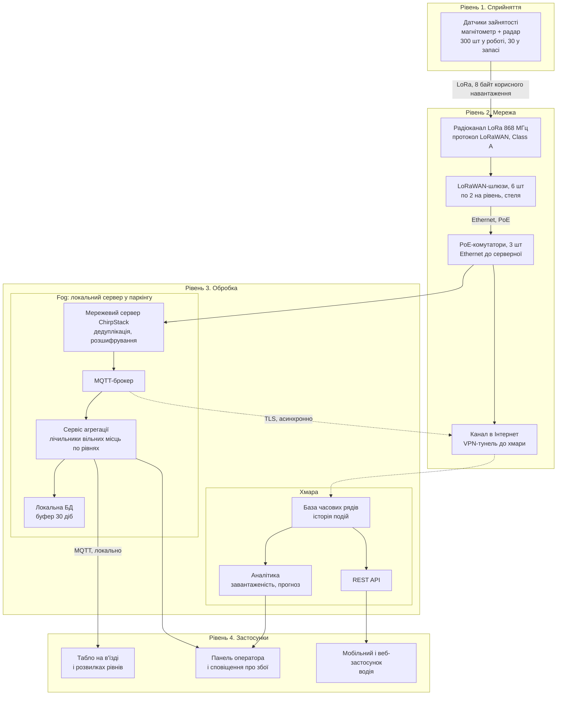
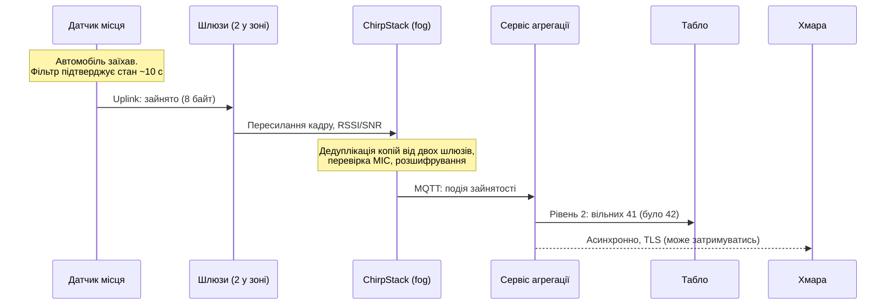

# Практична робота 1. Розумне паркування на 300 місць (варіант 3)

**Дисципліна:** Технології IoT та SMART-технології
**Тема:** Вступ до IoT та SMART-технологій
**Тип роботи:** аналітично-проєктна (без програмування)

## 1. Мета та вихідні припущення

Спроєктувати на рівні архітектури систему визначення зайнятості місць для міського паркінгу на 300 місць: обрати датчики, мережеву топологію й протокол, розрахувати кількість шлюзів та оцінити вартість розгортання.

Завдання не задає геометрію паркінгу, тому я фіксую модель, на якій побудовано всі розрахунки нижче:

| Параметр | Значення | Статус |
|---|---|---|
| Кількість місць | 300 | задано |
| Конструкція | закритий паркінг, 3 рівні по 100 місць | припущення |
| Розмір рівня | 60 × 42 м = 2520 м² (≈ 25 м² на місце разом із проїздами) | припущення |
| Перекриття між рівнями | залізобетон | припущення |
| Середня кількість паркувань на місце за добу | 6 (тобто 12 змін стану «зайнято/вільно») | припущення |
| Частка добових подій у годину пік | 20 % | припущення |
| Heartbeat (контрольне повідомлення) | 1 раз на годину | проєктне рішення |
| Частотний план | EU868 (Україна — UA868, див. розділ 5.5) | проєктне рішення |

Усі числа, позначені «припущення», можна змінити; формули наведені, тож розрахунок легко перерахувати.

## 2. Архітектура системи

### 2.1. Чотирирівнева діаграма

Шари (сприйняття, мережа, обробка, застосунки) відповідають еталонній моделі IoT за ITU-T Y.2060 [27]. Діаграми написано в синтаксисі Mermaid [28].

Ключова особливість: **критичний шлях «автомобіль зупинився → табло оновилося» не залишає будівлі**. Хмара потрібна для історії, аналітики та мобільного застосунку, але відмова Інтернету не зупиняє табло.

### 2.2. Послідовність обміну для однієї події

## 3. Склад системи

| № | Пристрій / компонент | Що вимірює або робить | Де розміщено |
|---|---|---|---|
| 1 | Датчик зайнятості місця (330 шт: 300 + 10 % запасу) | Магнітометр фіксує зміну магнітного поля від металевого корпусу авто, радар підтверджує присутність; передає стан, напругу батареї, температуру | На покритті кожного місця, поверхневий монтаж по центру місця |
| 2 | LoRaWAN-шлюз (6 шт) | Приймає радіокадри датчиків і пересилає їх мережевому серверу по Ethernet | Під стелею, по 2 на рівень (координати в розділі 6) |
| 3 | PoE-комутатор (3 шт, по одному на рівень) | Живить шлюзи по кабелю та об'єднує їх у локальну мережу | Технічна ніша кожного рівня |
| 4 | Локальний сервер (fog) | Мережевий сервер LoRaWAN, MQTT-брокер, сервіс агрегації, локальна БД | Серверна / технічна кімната на першому рівні |
| 5 | ДБЖ | Тримає сервер, комутатори та шлюзи під час короткого зникнення мережі | Поруч із сервером |
| 6 | Інформаційні табло | Показують кількість вільних місць по рівнях | В'їзд, розвилки до рівнів |
| 7 | Хмарний сервіс | Зберігає історію, рахує аналітику, віддає API | Дата-центр хмарного провайдера |
| 8 | Застосунок водія та панель оператора | Показують наявність місць; повідомляють оператору про несправні датчики | Смартфони, робоче місце оператора |

## 4. Де виконується обробка: edge, fog чи хмара

Вимога до затримки, що визначила вибір: **оновлення табло повинне відбуватися не довше ніж через 10 с після того, як авто зупинилось**. Це проєктна вимога (водій на в'їзді приймає рішення за секунди). Вона розкладається так: ~10 с — підтвердження стану на самому датчику, до 1–2 с — радіоканал і локальна обробка. Хмарний маршрут додає невизначену затримку каналу в Інтернет (від сотень мілісекунд до втрати зв'язку), тому на критичному шляху його немає.

| Задача | Рівень | Чому саме тут |
|---|---|---|
| Злиття сигналів магнітометра й радара, фільтр від брязкоту стану (debounce ~10 с), відправка лише при зміні стану плюс heartbeat | **Edge** (у датчику) | Радіопередача — головна стаття витрат енергії та ефіру; відправляти кожен відлік магнітометра неможливо ні за батареєю, ні за лімітом 1 % ефірного часу |
| Дедуплікація копій кадру від двох шлюзів, перевірка MIC, розшифрування, декодування 8 байт | **Fog** | Потрібно для кожної події одразу; не залежить від Інтернету |
| Підрахунок вільних місць по рівнях, керування табло | **Fog** | Вимога ≤ 10 с, працює при обриві зв'язку з хмарою |
| Виявлення «мовчазних» датчиків (немає heartbeat > 3 год) і сповіщення оператора | **Fog** | Оператор паркінгу має знати про збій навіть без Інтернету |
| Буфер подій (30 діб) | **Fog** | Після відновлення зв'язку події синхронізуються в хмару без втрат |
| Довгострокова історія, аналітика завантаженості, прогноз, публічний API, мобільний застосунок | **Хмара** | Потрібні масштаб, зберігання роками й доступ ззовні; затримка в десятки секунд припустима |

Резюме по затримках:

| Споживач даних | Допустима затримка | Місце обробки |
|---|---|---|
| Табло на в'їзді | ≤ 10 с | Fog |
| Сповіщення оператора про збій датчика | хвилини | Fog |
| Мобільний застосунок водія | ≤ 30–60 с | Хмара |
| Аналітика і звіти | години | Хмара |
